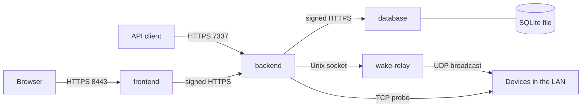
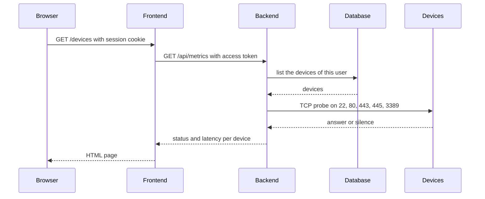

# Architecture

Four containers on one compose network. Only the frontend and the backend publish a port, both on `127.0.0.1` by default.

| Container | Task | Port | Volumes |
|---|---|---|---|
| `frontend` | Web UI (Flask). Keeps the sessions in memory and owns no data. | 8443, published on `FRONTEND_BIND_ADDRESS` | `frontend_tls_certs`, `frontend_logs` |
| `backend` | REST API. Validates input, checks roles, probes devices, asks the relay to wake. | 7337, published on `BACKEND_BIND_ADDRESS` | `tls_certs`, `wake_socket`, `backend_logs` |
| `database` | Owns the SQLite file. Accepts requests from the backend only. | 13110, not published | `database_tls_certs`, `sqlite_data`, `database_logs` |
| `wake-relay` | Sends the Wake-on-LAN packet. Uses the backend image and the host network, has no port. | none | `wake_socket` |

## Rules

- The frontend talks to the backend only. The browser never sees an access or refresh token; it only gets a session cookie.
- The backend owns no data. Without the database it answers `503`.
- Secrets are split: the frontend has no `JWT_SECRET` and no database secret, the database has no `JWT_SECRET` and no frontend secret.
- Every container runs as UID 10001 with `cap_drop: ALL` and `no-new-privileges`. `wake-relay` is also read-only.
- Each container creates its own self-signed certificate on the first start. How the containers trust each other: [Container trust](container-trust.md).

## Example: showing the device list

Related: [Data model](data-model.md), [Authentication](authentication.md), [Wake-on-LAN](wake-on-lan.md), [Logging](logging.md).
