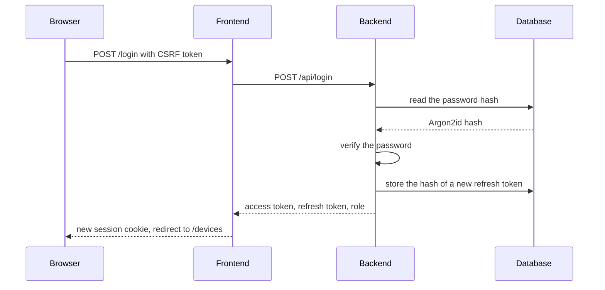
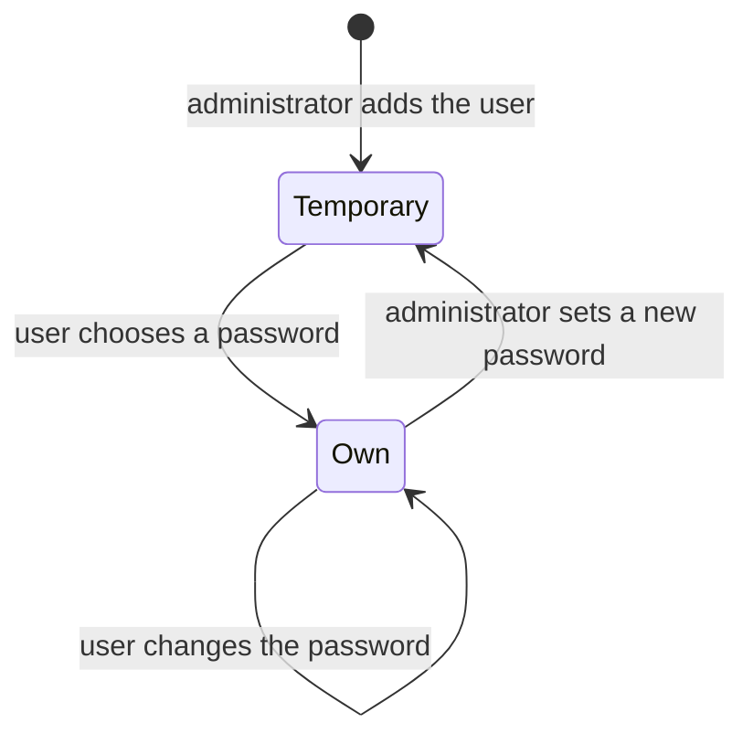

# Authentication

How users prove who they are. Container-to-container trust is a separate path: [Container trust](container-trust.md).

## Tokens and sessions

| Item | Lifetime | Notes |
|---|---|---|
| Access token | 5 minutes | JWT (HS256) signed by the backend. Sent as `Authorization: Bearer`. |
| Refresh token | 30 days | Random. Only its SHA-256 is stored. Ends on logout, password change, rename or deletion of the account. |
| Reset token | 15 minutes, once | Issued by the administrator over the API. Only its SHA-256 is stored. |
| Web session | 30 minutes idle, 12 hours at most | Cookie `__Host-pontifex-session` (`Secure`, `HttpOnly`, `SameSite=Strict`). The tokens stay on the server. |

- The backend checks the account in the database on every request, so a deleted account loses access at once.
- Every form of the web UI carries a CSRF token. A new session id is issued at sign-in.
- The status refresh of the device list does not count as activity.

## Sign-in

A wrong password and an unknown user give the same answer.

## Limits

| Where | Limit | Result |
|---|---|---|
| Backend | 5 failed sign-ins for one account or 30 from one address in 15 minutes | `429` with `Retry-After` |
| Frontend | 5 failed sign-ins from one client address in 15 minutes | sign-in refused for the rest of the window |
| Password change, rename, account deletion, reset token | wrong guesses count like failed sign-ins | `429` |
| Wake-on-LAN | one packet per device every 5 seconds | `429` with `Retry-After` |

Passwords are hashed with Argon2id and are 12 to 1024 characters long.

## Password set by the administrator

While the password is temporary, only sign-in, sign-out and the password change work. Everything else answers `403` with `"code": "password_change_required"`. The new password has to differ from the temporary one. The administrator account is never asked.
