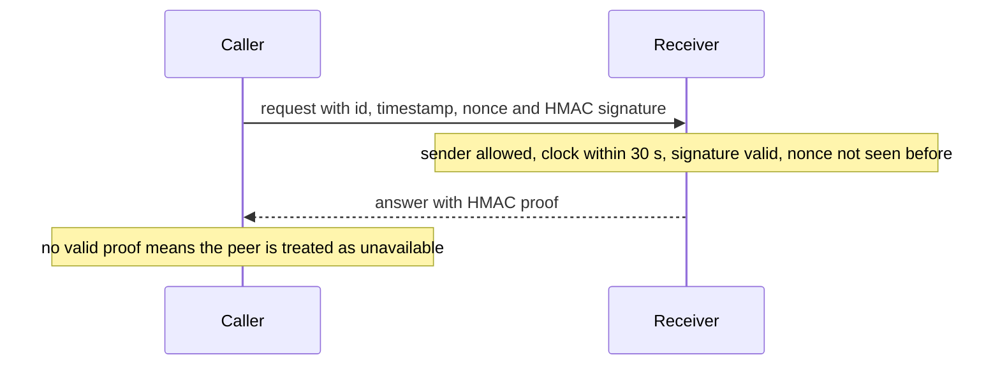
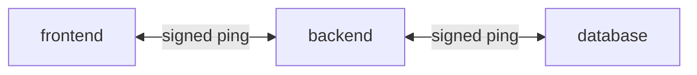

# Container trust

The containers prove their identity to each other with a shared secret that never leaves the container. Code: [`src/shared/container_auth.py`](../src/shared/container_auth.py).

| Pair | Secret in `.env` |
|---|---|
| frontend and backend | `BACKEND_FRONTEND_SECRET` |
| backend and database | `BACKEND_DATABASE_SECRET` |

A container does not start if a secret is missing or shorter than 32 characters.

## Signed request and signed answer

The signature covers sender, receiver, method, path, query, timestamp, nonce, body hash and the SHA-256 of the TLS certificate the receiver presents. The proof covers the same for the answer. Consequences:

- A captured request cannot be replayed (nonce) or changed (signature).
- A man in the middle with its own certificate fails in both directions, because the certificate is part of the signature.
- A container with a wrong secret is rejected, and so is an impostor that answers without a proof.

## Who may call whom

| Receiver | Allowed callers | Route |
|---|---|---|
| backend | frontend, database | `/api/internal/ping`; the frontend also signs its calls to the public API |
| database | backend | every route except `/api/health` |
| frontend | backend | `/internal/ping` |

The public API needs no container secret. A request without container headers is a normal request, a wrongly signed one is rejected with `401`.

## Peer checks

Each container pings its peers every `PEER_CHECK_INTERVAL_SECONDS` (default 30). A wrong secret shows up in the logs of both sides.
