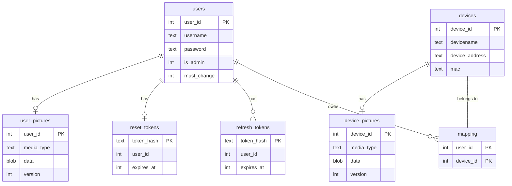

# Data model

SQLite, owned by the database container (`DB_PATH`, volume `sqlite_data`). Schema: [`schema.sql`](../src/database/app/schema.sql).

- `password` holds an Argon2id hash. Tokens are stored as SHA-256 hashes only.
- `must_change` is 1 while the password was chosen by the administrator.
- A device has one owner. The database service creates the device and its `mapping` row together.
- Pictures are in separate tables, so lists never carry image bytes. `version` changes with every upload.
- Deleting a user also deletes their devices, pictures and tokens.
- The table `bootstrap` has at most one row. It marks that the administrator was created, so the setup can run only once.
