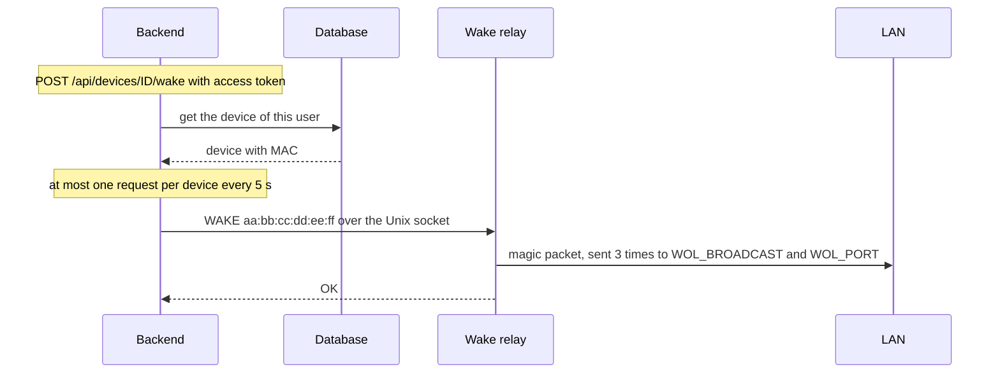

# Wake-on-LAN

A UDP broadcast from the container network never reaches the LAN. A separate `wake-relay` container in the host network sends the packet. Setup of the network and of the device: see the README.

- The request carries no MAC, address or port. The MAC comes from the stored device, the destination from the environment of the relay.
- The relay accepts nothing but `WAKE <mac>`. The socket is private to the relay user, at most 8 connections are served at once.
- `sent` means the packet was handed to the network. Whether the device woke up shows in its status.

| Answer | Reason |
|---|---|
| `200` | packet sent |
| `404` | device unknown or owned by somebody else |
| `429` | the device was woken less than 5 seconds ago |
| `503` | the relay is not running |
